# 밀수 게임 - Contraband

## 설명

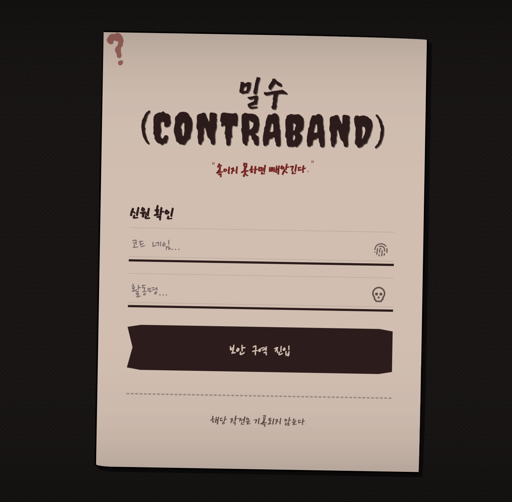

- 밀수꾼은 돈을 숨겨 빼돌리고, 검사관은 검문을 통해 빼돌린 돈을 압수한다.
- 서로의 심리를 읽어 더 많은 돈을 확보하는 팀이 승리한다.

### 로비 관련

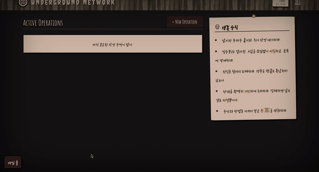

- 게임 룰 버튼을 누르면 밀수 게임의 룰을 확인할 수 있다.

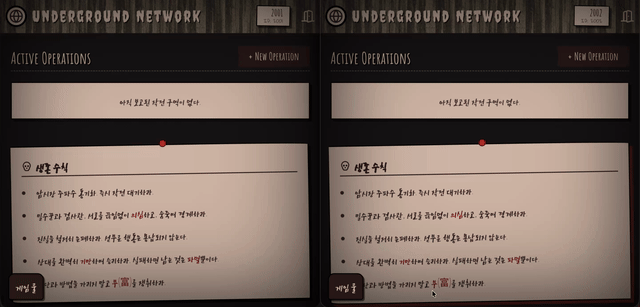

- 생성된 로비의 상태를 실시간으로 확인할 수 있다.

---

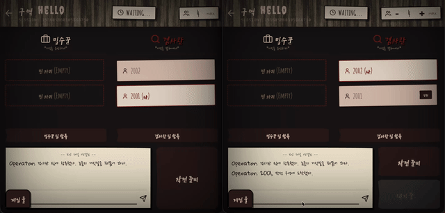

- 로비 내에서 작전 준비 / 작전 준비 취소(Ready Toggle), 팀 이동, 인원 수 변경이 가능하며 변경 사항은 실시간으로 반영된다.

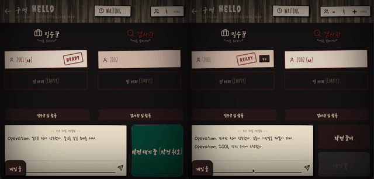

- 방장은 플레이어를 로비에서 강퇴할 수 있다.

## 게임 진행

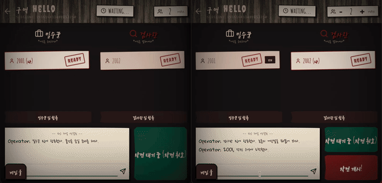

- 로비에서 실시간 채팅이 가능하며, 모든 인원이 작전 준비가 된 상태에서 방장이 게임을 시작할 수 있다.
- 밀수꾼과 검사관의 선택에 따라 라운드 승리 여부가 결정된다.
- 게임 종료 시 게임 결과 및 소속 팀에 따라 결과 문구가 다르게 출력된다.

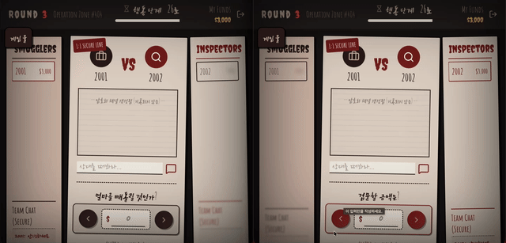

- 상단의 제한 시간 30초가 지나면 룰 상으로 정의된 기본 동작을 수행한다.

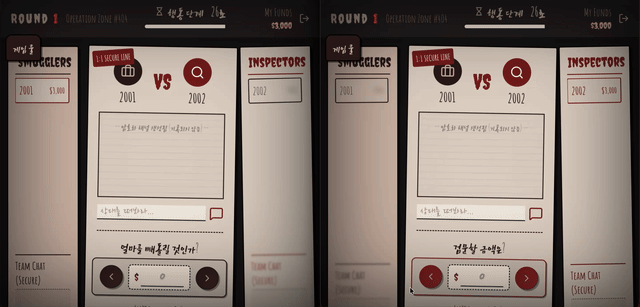

- 1:1 게임의 경우 해당 라운드에 참가할 플레이어를 결정하는 단계를 생략한다.

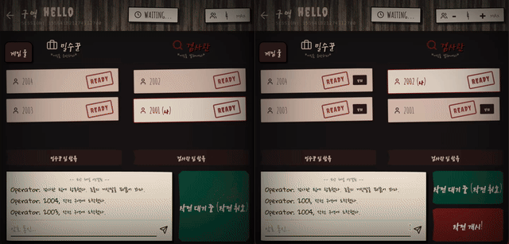

- 2:2, 3:3 게임의 경우 해당 라운드에 참가할 플레이어를 결정해야 한다.
- 제한시간 동안 선정하지 않는 경우 무작위로 참가할 플레이어가 결정된다.
- 다른 플레이어에게 금액을 송금할 수 있다.

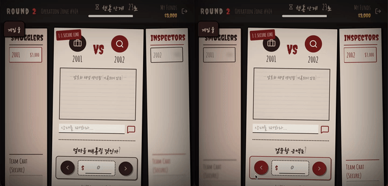

- 기존에 진행하고 있던 게임에 다시 참여할 수 있다.

## 모니터링 및 관리

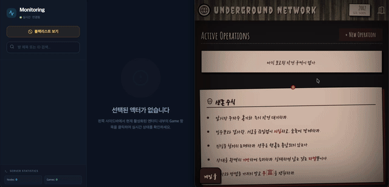

- 진행하고 있는 모든 게임 방을 모니터링 할 수 있으며, 채팅을 차단할 수 있다.
- 채팅을 차단하는 경우 차단된 플레이어가 지금까지 작성된 메시지가 모두 마스킹 된다.

## 텍스트 버전 룰

[밀수 게임 룰](./RULE.md)
